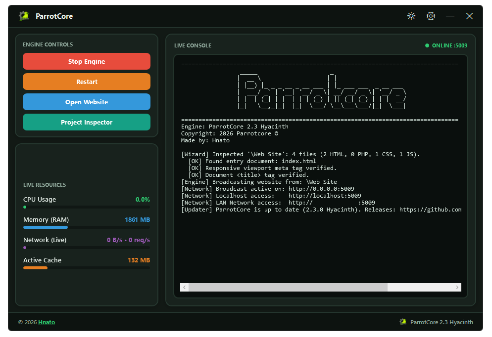
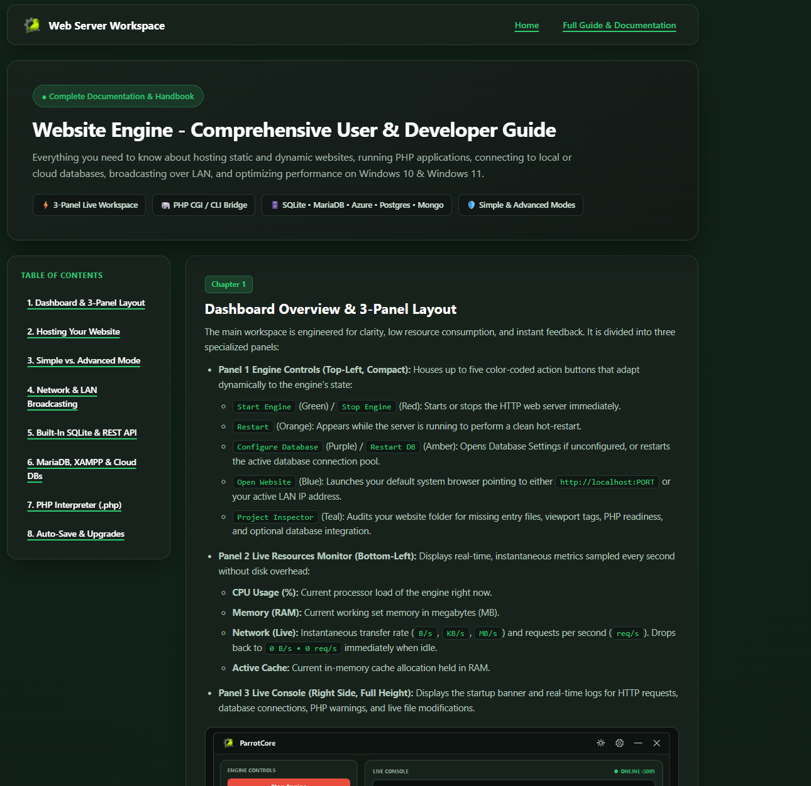

 

**The Ultimate All-in-One Windows Website Engine & Database Host**

---

## 🦜 Welcome to ParrotCore!

Tired of heavy, complicated web server stacks just to host or test your websites? **ParrotCore** is your ultimate all-in-one website engine for Windows 10 and Windows 11. Simply drop your website files into the `Web Site` folder, hit **Start Engine**, and broadcast your site instantly on `localhost` or across your entire LAN network (`0.0.0.0`).

Version **2.3 "Hyacinth"** is our fastest, cleanest, and most versatile release yet — featuring a real-time 3-panel desktop workspace, native PHP interpretation, zero-config SQLite & Key-Value APIs, external database connectors, and automatic starter template recovery.

  

---

## 🔥 Why Choose ParrotCore?

### 🌐 Instant Website Broadcasting & PHP Support
- **Drop & Host:** Place your HTML, CSS, JS, or PHP files into the `Web Site` folder (or pick any custom folder on your disk) and go live in milliseconds.
- **Localhost & LAN Modes:** Keep your project private on `127.0.0.1` or broadcast on `0.0.0.0` so smartphones, tablets, and other PCs on your Wi-Fi/LAN can access it immediately.
- **Built-In PHP Bridge:** Native support for `.php` scripts via `php-cgi.exe` / `php.exe` with automatic interpreter discovery.
- **Smart Port & Firewall Diagnostics:** Built-in collision checker and one-click Windows Firewall rule assistant.

### 🗄️ Total Database Freedom
Don't waste hours configuring database drivers. ParrotCore adapts automatically to your stack:
- **Built-in SQLite + REST API:** Zero-configuration local database with ready-to-use `/api/db/kv` (Key-Value) and `/api/db/query` (SQL) HTTP endpoints.
- **Local MariaDB / XAMPP:** Seamless presets for local MySQL and MariaDB servers.
- **Enterprise & Cloud Databases:** Native connection builders and auto-generated `parrotcore-db.json` configs for **Microsoft Azure SQL**, **SQL Server**, **PostgreSQL**, **MySQL**, and **MongoDB**.

### 🎨 Your Workspace, Your Rules
- **Simple & Advanced Modes:** Switch between a foolproof **Simple Mode** for effortless one-click hosting and **Advanced Mode** for full control over caching, CORS, PHP binaries, and external database pools.
- **Dark & Light Themes:** Signature forest-emerald Dark Theme and high-contrast Light Theme.
- **7 Built-in Languages:** Full localization in English, Polish, German, French, Chinese, Japanese, and Norwegian Bokmål.
- **Instant Auto-Save & Backup Recovery:** Settings save automatically, and the built-in template backup can restore the default starter website and documentation at any time.

---

## 🖥️ Powerful Yet Lightweight

ParrotCore combines a high-speed HTTP engine with a sleek **3-Panel Windows Desktop Manager** designed for zero bloat and instant visual feedback:

  

- ⚡ **3-Panel Live Workspace:** Dedicated panels for **Engine Controls**, **Live Resource Telemetry** (real-time CPU %, RAM MB, instantaneous Network B/s & req/s, and Active Cache), and a **Full-Height Live Console**.
- 🔍 **Project Inspector Wizard:** Audits your website folder for entry files, responsive viewport metadata, PHP readiness, and database configuration.
- 📦 **Upgrade-Safe Architecture:** Preserves your settings across updates via dual configuration persistence and Inno Setup installer integration.

---

## ⚙️ How to Get Started

Setting up your own web server with ParrotCore takes seconds:

1. **Download:** Grab the latest `ParrotCore` installer or release package from [GitHub Releases](https://github.com/Hnato/Parrotcore/releases).
2. **Add Your Website:** Drop your project files into the `Web Site` folder (or select any directory in **Settings -> Website**).
3. **Launch:** Open **ParrotCore.exe** and click **Start Engine**.
4. **Go Live:** Click **Open Website** to view your site in your browser or share your LAN address with your network!

---

## 🛠 For the Geeks (Tech Stack)

Built with passion for maximum speed, portability, and low memory footprint:
- **Desktop Host & Engine:** .NET 8.0 (WPF + High-Concurrency `HttpListener` Engine), FileSystemWatcher Hot-Reload
- **Database Drivers:** `Microsoft.Data.Sqlite`, ADO.NET & JSON Bridge Generator (`parrotcore-db.json` / `parrotcore-db.js`)
- **Web Runtime:** HTML5, CSS3, Vanilla ES6+ JavaScript, PHP CGI / CLI Middleware

---

## 👑 The Mastermind

Crafted with 💖 by:
- 👨‍💻 ** (["Hnato"](https://github.com/Hnato))**

&copy; 2026 ParrotCore Hnato  

